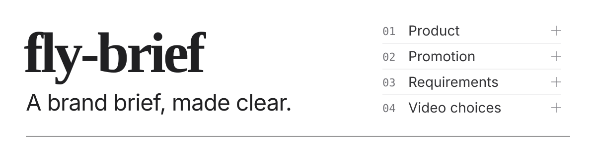

[简体中文](./README.md) · **English**

<p>
  
</p>

**A brief is supposed to be a short task overview. So why do brands send a bloated wall of text and call it a brief?**

fly-Brief is an agent skill for creators. Give your agent the brief and supporting material, and get a concise, visual HTML report you can open locally: what the product does, what to promote, the requirements, and concrete video topics to choose from—all clearly laid out.

[Live preview](https://flyl1u.github.io/fly-brief/) · [Install](#install) · [First use](#first-use) · [Try the example](#try-the-example)

## See the result

This is a local HTML page created by an agent using fly-Brief. ***Click the plus sign to expand each section for more detail***, or follow the source links to the original material. Real briefs cannot be shared publicly, so this example uses a fictional brief. The screenshot below is static; open the [live preview](https://flyl1u.github.io/fly-brief/) to explore the report.


## Four questions, answered

| Question | What you get |
| --- | --- |
| What does the product do? | A plain explanation of its capabilities, inputs, outputs, and conditions. |
| What should I promote? | The campaign's focus, separated from the full feature list. |
| What are the requirements? | Mandatory shots, wording, restrictions, deadlines, and unresolved issues. |
| What could this video be? | Concrete topics with a title, creator perspective, promoted features, pain point, and case details. |

**Read the short conclusions first, then expand for the explanation.** Important shooting requirements remain visible while collapsed; `[原文]` opens the supporting passages, so you can check a claim without searching through the brief again.

Video ideas name a person, a problem, the material to prepare, and a useful result. Each explains how the video could develop, while leaving the full script to you.

## Install

Send this request to an agent that supports skills and let it handle the installation:

```text
Please install the fly-brief skill from https://github.com/flyl1u/fly-brief
and configure it for this agent's skill directory and setup.
```

Generating reports requires **Python 3.10+**; your agent can check the environment. Reading attachments and links uses the tools and access already available to the agent.

## First use

Attach the brief, paste the text, or provide a readable link. Add any known audience, account style, or platform details, then ask:

```text
Use $fly-brief to read this brand brief and its attachments.
Explain the four questions and generate a local interactive HTML report.
Give me a few concrete video topics to choose from, without writing a full script.
Save the result in output/my-campaign/.
```

The agent reads the material, writes source-linked report data, validates it, and fills the fixed template. Open the resulting `report.html` in a browser. Sections expand independently, and source excerpts open on demand.

**The generated report works offline:** it needs no build step, remote library, API key, or running server. Original-file and reference-video links still need their files or network access. Running your agent may have its own model and tool requirements.

## Try the example

[Open the fictional Suijian brief report](https://flyl1u.github.io/fly-brief/) to expand all four sections and check their sources.

Clone the repository and run from its root:

```sh
git clone https://github.com/flyl1u/fly-brief.git
cd fly-brief
python scripts/render_report.py --input examples/report.json --output output/demo/report.html
```

Open `output/demo/report.html`. The fictional [brief](./examples/brief.md) and [report data](./examples/report.json) show the complete path from material to output. The generator renders prepared JSON; the agent performs the brief analysis.

To validate data without generating a file:

```sh
python scripts/render_report.py --input examples/report.json --check
```

## What the report keeps explicit

- **Facts and requirements have sources.** Claims, obligations, and conflicts link to excerpts with a page, section, or other location.
- **Suggestions stay suggestions.** Creative scenarios and proposed identities are distinguished from known facts about the creator.
- **Missing information stays visible.** Inaccessible material, unclear promotion priorities, and conflicting instructions are identified.
- **Private material stays local by default.** Client briefs and generated reports belong in ignored `output/`; the public examples are fictional. Remote reading or model processing still depends on your agent and tools.

Fly Brief does not verify a brand's claims by testing its product, invent unseen reference-video analysis, or write a full script by default.

## For contributors

The core files are [SKILL.md](./SKILL.md), the [data contract](./references/report-format.md), the [HTML template](./assets/report.html), and the [renderer](./scripts/render_report.py). The [design notes](./DESIGN.md) record the selected document layout.

Run the renderer checks:

```sh
python -m unittest discover -s tests -v
```

Template changes also need desktop and mobile visual checks. Keep the four primary questions, visible shooting requirements, traceable sources, and standalone HTML behavior. Never include real client material in a contribution.

Bundled Noto fonts include their [source notes and SIL Open Font Licenses](./assets/fonts/SOURCES.md).
