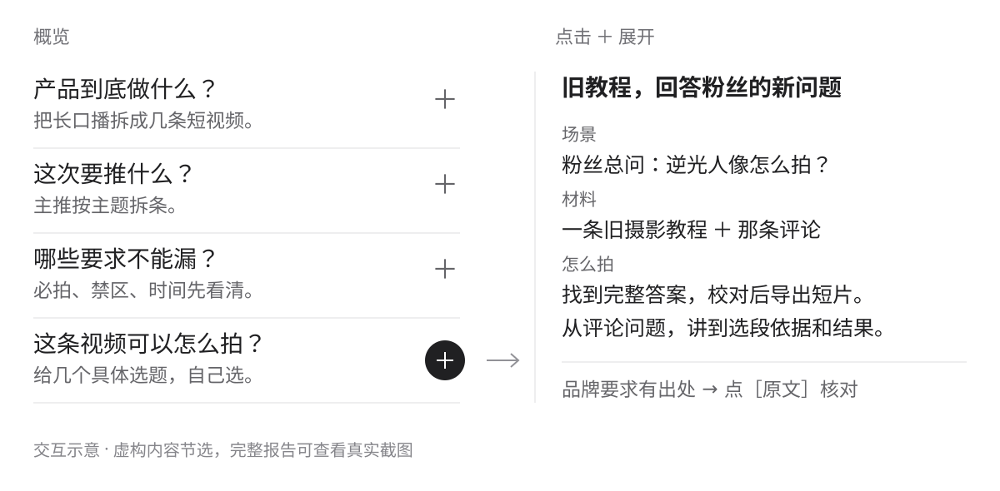

[简体中文](./README.md) · **English**

# Fly Brief

Turn a brand brief into clear priorities, filming requirements, and concrete video ideas for creators.

<picture>
  <source media="(max-width: 600px)" srcset="./assets/readme/reading-flow-mobile.svg">
  
</picture>

Scan the answers → expand with `+` → check the source with `[原文]`.

## Get started

With Node.js available, install through the [Skills CLI](https://github.com/vercel-labs/skills) and choose your agent:

```sh
npx skills add flyl1u/fly-brief --skill fly-brief
```

Attach a brief, paste its text, or provide an accessible link, then ask:

```text
Use $fly-brief to read this brand brief and generate a local HTML report.
Give me concrete video topics to choose from, without writing a full script.
```

The generated report opens offline, with no build step, API key, or running server. The renderer needs Python 3.10+; reading attachments depends on your agent's tools and access.

## See the real example

These are actual interface captures from one fictional brief. Expand whichever part interests you.

<details>
<summary>Product explanation: inputs, outputs, and conditions</summary>

<picture>
  <source media="(max-width: 600px)" srcset="./assets/readme/product-expanded-mobile.png">
  
</picture>

</details>

<details>
<summary>Concrete video topic: the case, material, and progression</summary>

<picture>
  <source media="(max-width: 600px)" srcset="./assets/readme/topic-expanded-mobile.png">
  
</picture>

</details>

<details>
<summary>Source evidence: document, location, and original passage</summary>

<picture>
  <source media="(max-width: 600px)" srcset="./assets/readme/source-open-mobile.png">
  
</picture>

</details>

<details>
<summary>Run the example and contribute</summary>

Try the [fictional brief](./examples/brief.md) and [report data](./examples/report.json) without supplying client material:

```sh
git clone https://github.com/flyl1u/fly-brief.git
cd fly-brief
python scripts/render_report.py --input examples/report.json --output output/demo/report.html
```

Open `output/demo/report.html`. The renderer turns prepared data into HTML; the agent analyzes the brief.

Core files: [skill rules](./SKILL.md) · [data contract](./references/report-format.md) · [template](./assets/report.html) · [renderer](./scripts/render_report.py).

```sh
python -m unittest discover -s tests -v
```

Template changes also need desktop and mobile visual checks. Bundled fonts include [source notes and licenses](./assets/fonts/SOURCES.md).

</details>

The report currently uses Chinese. Brand requirements and creative suggestions are kept distinct, and inaccessible material is identified. Client material and generated reports stay in ignored `output/` by default. Model calls and remote reading depend on your agent and tools.
