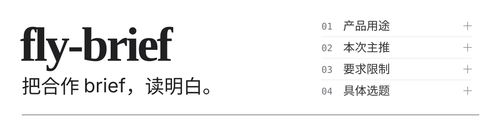
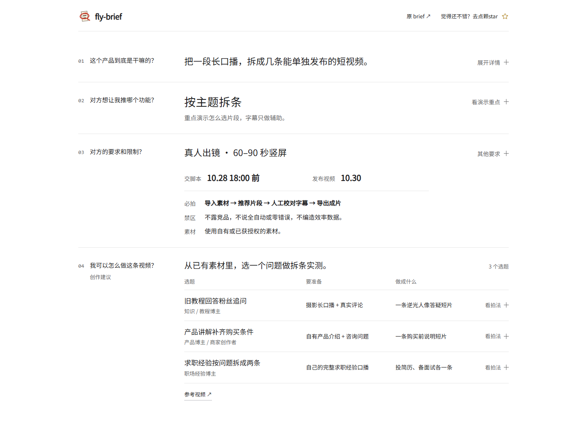

中文 · [English](./README.en.md)

<p>
  
</p>

**brief 这个词原本的意思是任务简介，但现在的品牌方把brief写的又臭又长，你管这玩意叫bf?**

fly-Brief 是给博主用的 agent skill，只需把 brief 和补充材料交给 agent，你就可以得到一份本地的精简可视化 HTML 报告：产品做什么、这次推什么、有哪些要求，以及可以选择的具体视频选题，看都看得一清二楚

## 先看效果

下面是 fly-Brief 根据虚构合作生成的报告。交脚本、发布视频的时间和必拍流程默认可见；视频选题按“要准备什么、做成什么”并排比较。点击“展开详情”或“看拍法”再读具体内容，也能点“原文”核对材料。真实客户资料不公开，想试试交互可打开 [在线体验](https://flyl1u.github.io/fly-brief)。



## 四个问题，读完就清楚

| 问题 | 报告给你什么 |
| --- | --- |
| 这个产品到底是干嘛的？ | 用直白的话解释能力、输入、产物和使用条件。 |
| 对方想让我推哪个功能？ | 分清本次主推和产品的完整功能清单。 |
| 对方的要求和限制？ | 必拍画面、必讲文案、禁区、时间和待确认事项。 |
| 我可以怎么做这条视频？ | 标题、达人视角、推广功能、具体痛点和选题详情。 |

**默认先看结论、要求和选题差别，展开再看解释与拍法。** 产品详情按输入、工具处理、人工判断和产物分组；重要拍摄要求始终可见。点“原文”就能核对对应材料，不用重新翻整份 brief。

视频方向会讲清谁遇到什么问题、准备什么材料、做出什么成果，以及内容怎样推进。细到能选题，完整脚本留给下一步。

## 安装

将下面的请求发送给支持 skill 的 agent，由它完成安装：

```text
请使用 `npx skills add flyl1u/fly-brief` 安装 fly-brief skill，
并按照当前 agent 的技能目录和配置方式完成设置。
```

生成报告需要 **Python 3.10+**；可让 agent 检查当前环境。读取附件和链接时，使用 agent 已有的工具与访问权限。

## 开始使用

附上 brief、粘贴正文，或提供可读取的链接；如果已知账号受众、表达风格和发布平台，也可以一起说明：

```text
使用 $fly-brief 读取这份合作 brief 和附件。
讲清四个问题，生成可以本地打开的交互 HTML 报告。
给几个可以选择的具体视频选题，先不写完整脚本。
保存到 output/my-campaign/。
```

Agent 会读取材料，整理带来源的数据，校验后填入固定模板。用浏览器打开生成的 `report.html`，前三块可以独立展开，每个视频选题单独查看拍法，原文按需查看。

**生成后的报告可离线打开**：不需要构建、远程库、API Key 或运行中的服务。原始文件和参考视频链接仍需要对应文件或网络；运行 agent 本身可能需要模型和工具配置。

## 试跑示例

[在线预览“随剪”模拟 brief 报告](https://flyl1u.github.io/fly-brief)，可以直接展开四个部分并查看来源。

克隆仓库，在根目录执行：

```sh
git clone https://github.com/flyl1u/fly-brief.git
cd fly-brief
python scripts/render_report.py --input examples/report.json --output output/demo/report.html
```

打开 `output/demo/report.html`。虚构的 [brief](./examples/brief.md) 和 [报告数据](./examples/report.json) 展示了从材料到报告的完整示例。生成器负责把已有 JSON 渲染为页面，brief 分析由 agent 完成。

只检查数据、不生成文件：

```sh
python scripts/render_report.py --input examples/report.json --check
```

## 这些边界会说清楚

- **事实和要求有出处。** 产品信息、品牌要求和冲突关联原句，并保留页码、段落等位置。
- **建议就是建议。** 创作场景、建议身份和已知的博主信息分开表达。
- **没读到，不假装知道。** 无法访问的资料、未明确的主推和相互冲突的口径都会标出。
- **客户资料默认留在本地。** Brief 和生成报告放在 Git 忽略的 `output/`，公开样例均为虚构。远程读取和模型处理仍取决于 agent 与工具。

Skill 不代替产品实测，不编造未看过的参考视频分析，也不默认写完整脚本。

## 参与维护

核心文件是 [SKILL.md](./SKILL.md)、[数据约定](./references/report-format.md)、[HTML 模板](./assets/report.html) 和 [生成器](./scripts/render_report.py)。[设计记录](./DESIGN.md) 说明了当前选定的白纸文档布局。

运行生成器检查：

```sh
python -m unittest discover -s tests -v
```

修改模板后还需查看桌面和手机效果。保留四个主问题、默认可见的关键拍摄要求、可追溯来源和独立 HTML 能力。提交内容不要包含真实客户资料。

内置 Noto 字体附有 [来源说明与 SIL Open Font License](./assets/fonts/SOURCES.md)。
