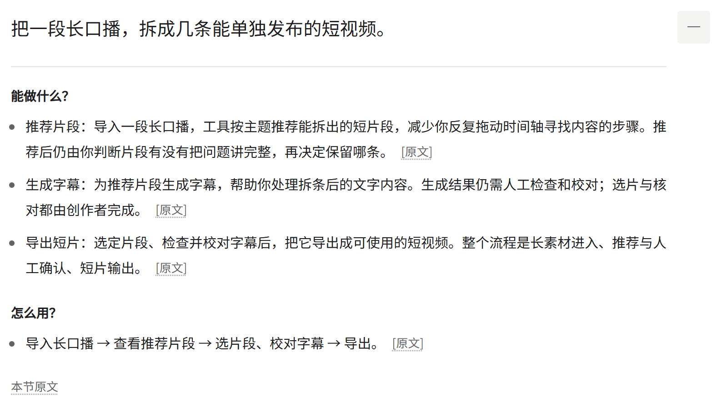
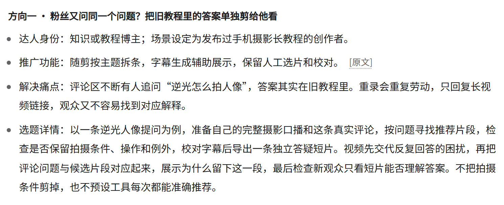
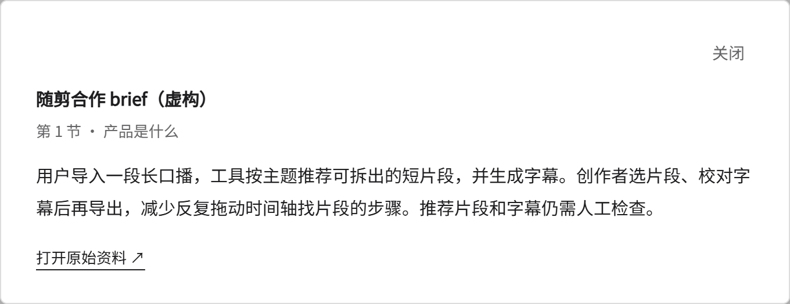
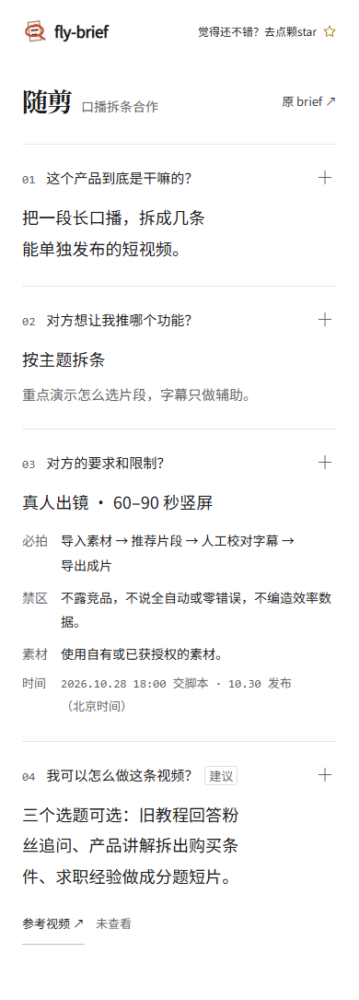

**简体中文** · [English](./README.en.md)

<p>
  
</p>

Fly Brief 是给接品牌合作的博主用的 agent skill。把 brief 和补充材料交给 agent，得到一份本地 HTML 报告：产品做什么、这次推什么、有哪些要求，以及可以选择的具体视频选题。

[安装](#安装) · [开始使用](#开始使用) · [试跑示例](#试跑示例)

## 先看交互：点「＋」，展开细节

报告默认显示四问概览。**每一行右侧的 `＋` 都能独立展开；内容里的 `[原文]` 可以打开来源摘录。** 展开后，功能解释、使用条件、完整要求和具体选题都能继续往下读。

下面直接展示同一份**虚构示例的真实展开状态**。这些图片是截图；实际点击交互在生成的 `report.html` 中进行。

### 展开产品说明：知道怎么用，也知道哪里需要人工

每项能力分别说明输入、处理、产物和使用条件；有依据的解释附上 `[原文]`。

<picture>
  <source media="(max-width: 600px)" srcset="./assets/readme/product-expanded-mobile.png">
  
</picture>

### 展开视频方向：选题具体到场景、材料和成果

这是三个备选方向中的一个。每个方向都有**标题、达人身份、推广功能、解决痛点、选题详情**，能据此决定准备什么、拍什么。

<picture>
  <source media="(max-width: 600px)" srcset="./assets/readme/topic-expanded-mobile.png">
  
</picture>

### 点击原文：直接核对依据

资料名称、段落位置、原句摘录和原始文件入口一起显示。

<picture>
  <source media="(max-width: 600px)" srcset="./assets/readme/source-open-mobile.png">
  
</picture>

目前报告界面和默认文案使用中文。以上均为虚构样例，不含真实客户资料。

<details>
<summary>补充查看：收起时的四问概览与手机布局</summary>

<p>
  
</p>

<p>
  
</p>

</details>

## 四个问题，读完就清楚

| 问题 | 报告给你什么 |
| --- | --- |
| 这个产品到底是干嘛的？ | 用直白的话解释能力、输入、产物和使用条件。 |
| 对方想让我推哪个功能？ | 分清本次主推和产品的完整功能清单。 |
| 对方的要求和限制？ | 必拍画面、必讲文案、禁区、时间和待确认事项。 |
| 我可以怎么做这条视频？ | 标题、达人视角、推广功能、具体痛点和选题详情。 |

默认先看简明结论，展开再看解释。重要拍摄要求收起后也不会消失；点 `[原文]` 就能核对对应材料，不用重新翻整份 brief。

视频方向会讲清谁遇到什么问题、准备什么材料、做出什么成果，以及内容怎样推进。细到能选题，完整脚本留给下一步。

## 安装

有 Node.js 时，通过 [Skills CLI](https://github.com/vercel-labs/skills) 安装：

```sh
npx skills add flyl1u/fly-brief --skill fly-brief
```

按提示选择你的 agent。希望跨项目使用时，加上 `-g`。如果你的 agent 直接加载 skill 文件夹，也可以把仓库克隆到它的技能目录；请保留 `SKILL.md`、`scripts/`、`assets/` 和 `references/` 的相对位置。

生成器需要 **Python 3.10+**，只使用标准库。读取 PDF、幻灯片、图片或需要登录的链接，取决于 agent 已有的提取工具和访问权限。

## 开始使用

附上 brief、粘贴正文，或提供可读取的链接；如果已知账号受众、表达风格和发布平台，也可以一起说明：

```text
使用 $fly-brief 读取这份合作 brief 和附件。
讲清四个问题，生成可以本地打开的交互 HTML 报告。
给几个可以选择的具体视频选题，先不写完整脚本。
保存到 output/my-campaign/。
```

Agent 会读取材料，整理带来源的数据，校验后填入固定模板。用浏览器打开生成的 `report.html`，各块可以独立展开，原文按需查看。

**生成后的报告可离线打开**：不需要构建、远程库、API Key 或运行中的服务。原始文件和参考视频链接仍需要对应文件或网络；运行 agent 本身可能需要模型和工具配置。

## 试跑示例

克隆仓库，在根目录执行：

```sh
git clone https://github.com/flyl1u/fly-brief.git
cd fly-brief
python scripts/render_report.py --input examples/report.json --output output/demo/report.html
```

打开 `output/demo/report.html`。虚构的 [brief](./examples/brief.md) 和 [报告数据](./examples/report.json) 展示了从材料到报告的完整示例。生成器负责把已有 JSON 渲染为页面，brief 分析由 agent 完成。

只检查数据、不生成文件：

```sh
python scripts/render_report.py --input examples/report.json --check
```

## 这些边界会说清楚

- **事实和要求有出处。** 产品信息、品牌要求和冲突关联原句，并保留页码、段落等位置。
- **建议就是建议。** 创作场景、建议身份和已知的博主信息分开表达。
- **没读到，不假装知道。** 无法访问的资料、未明确的主推和相互冲突的口径都会标出。
- **客户资料默认留在本地。** Brief 和生成报告放在 Git 忽略的 `output/`，公开样例均为虚构。远程读取和模型处理仍取决于 agent 与工具。

Skill 不代替产品实测，不编造未看过的参考视频分析，也不默认写完整脚本。

## 参与维护

核心文件是 [SKILL.md](./SKILL.md)、[数据约定](./references/report-format.md)、[HTML 模板](./assets/report.html) 和 [生成器](./scripts/render_report.py)。[设计记录](./DESIGN.md) 说明了当前选定的白纸文档布局。

运行生成器检查：

```sh
python -m unittest discover -s tests -v
```

修改模板后还需查看桌面和手机效果。保留四个主问题、默认可见的关键拍摄要求、可追溯来源和独立 HTML 能力。提交内容不要包含真实客户资料。

内置 Noto 字体附有 [来源说明与 SIL Open Font License](./assets/fonts/SOURCES.md)。
